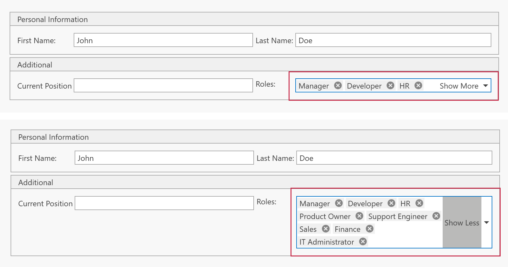

<!-- default badges list -->

[](https://supportcenter.devexpress.com/ticket/details/T1333061)
[](https://docs.devexpress.com/GeneralInformation/403183)
[](#does-this-example-address-your-development-requirementsobjectives)
<!-- default badges end -->

# WPF ComboBoxEdit — Add a "Show More" Button to Reveal All Selected Tokens

This example attaches a reusable behavior to a [ComboBoxEdit](https://docs.devexpress.com/WPF/DevExpress.Xpf.Editors.ComboBoxEdit) that displays selected items as tokens. If the selected tokens do not fit in the editor's input box, the behavior displays a **Show More**/**Show Less** toggle button that expands or collapses the editor.



## Overview

The `ComboBoxEdit` control in this example uses [CheckedTokenComboBoxStyleSettings](https://docs.devexpress.com/WPF/DevExpress.Xpf.Editors.CheckedTokenComboBoxStyleSettings) to render selected values as tokens. If the tokens do not fit in the input box, the editor increases its height and displays a scrollbar by default. The `ShowMoreBehavior` provides an alternative user experience: it keeps the editor at a fixed height and displays a toggle button that allows users to show all tokens on demand.

The `ShowMoreBehavior` is self-contained and MVVM-friendly. You can attach it to any token-based `ComboBoxEdit` and set `CollapsedHeight`:

```xml
<dxe:ComboBoxEdit ItemsSource="{Binding AvailableRoles}"
                  EditValue="{Binding CurrentEmployee.RoleIds}"
                  DisplayMember="Name" ValueMember="Id">
    <dxmvvm:Interaction.Behaviors>
        <local:ShowMoreBehavior CollapsedHeight="22"/>
    </dxmvvm:Interaction.Behaviors>
</dxe:ComboBoxEdit>
```

## Implementation Details

The core logic is implemented in [ShowMoreBehavior.cs](./CS/ShowMoreBehavior.cs). The class makes the following adjustments to `ComboBoxEdit` functionality:

- **Token wrapping** — applies `CheckedTokenComboBoxStyleSettings` and enables `EnableTokenWrapping` to display selected values as tokens arranged on multiple lines.
- **Show More/Show Less button** — adds an editor button to `ComboBoxEdit.Buttons`. The button toggles the editor height (`ComboBoxEdit.MaxHeight`) and its own caption between "Show More" and "Show Less".
- **Button visibility** — binds the inner `ScrollViewer.ScrollableHeight` and displays the button only when the tokens overflow the collapsed editor (`ScrollableHeight > 0`) or the editor is expanded.

### Files to Review

- [ShowMoreBehavior.cs](./CS/ShowMoreBehavior.cs)
- [MainWindow.xaml](./CS/MainWindow.xaml)
- [MainViewModel.cs](./CS/MainViewModel.cs)
- [Employee.cs](./CS/Employee.cs)
- [EmployeeRole.cs](./CS/EmployeeRole.cs)

## Documentation

- [ComboBoxEdit](https://docs.devexpress.com/WPF/DevExpress.Xpf.Editors.ComboBoxEdit)
- [ComboBoxEdit Operation Modes (Token / Checked Token)](https://docs.devexpress.com/WPF/116528/controls-and-libraries/data-editors/common-features/editor-operation-modes/comboboxedit#checked-token-combobox)
- [CheckedTokenComboBoxStyleSettings](https://docs.devexpress.com/WPF/DevExpress.Xpf.Editors.CheckedTokenComboBoxStyleSettings)
- [ButtonInfo](https://docs.devexpress.com/WPF/DevExpress.Xpf.Editors.ButtonInfo)
- [Behaviors (DevExpress MVVM)](https://docs.devexpress.com/WPF/17442/mvvm-framework/behaviors)
